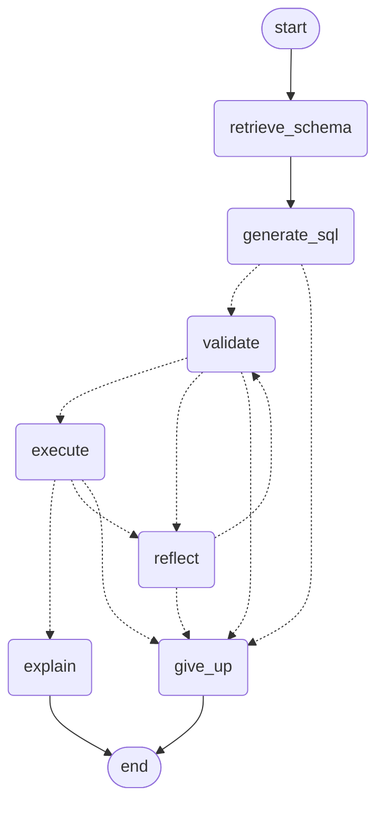

# NL2SQL — Text-to-SQL Analytics Agent

Ask a plain-English question about a Brazilian e-commerce dataset. A LangGraph
agent inspects the schema, writes SQLite, runs it **read-only**, and — the
point of the project — reads its own database errors and rewrites the query
when it gets something wrong.

```
Q: Which products are in the health_beauty category?

  attempt 1: SELECT * FROM products WHERE product_category_name = 'health_beauty'
             -> 0 rows  (English name compared against a Portuguese column)

  attempt 2: SELECT p.* FROM products p
             JOIN product_category_translation t
               ON t.product_category_name = p.product_category_name
             WHERE t.product_category_name_english = 'health_beauty'
             -> 2,444 rows
```

That recovery — visible, not hidden — is the entire thesis of the project: an
agent that silently returns a wrong answer is indistinguishable from a lookup
table, and one that visibly fixes its own mistake obviously isn't one.

## Why a baseline, not just an agent

The repo evaluates **two systems against the same 42-question test set**:

- `baseline.py` — dumb on purpose. Dump the whole schema into one prompt, ask
  once, run it once, no retries. This is the control.
- `graph.py` — the agent. Same prompts, same schema renderer, but wrapped in
  a generate → validate → execute → **reflect** loop.

Both return the identical result shape (`state.RESULT_KEYS`), so
`eval/run_eval.py` scores them through one code path. The number that matters
isn't "the agent got 83%" — it's "the agent gained *N* points over the
control by doing X," because that's the only claim an evaluation harness can
actually back up.

## Results

42-question test set (12 easy / 17 medium / 13 hard), execution-accuracy
scored (`compare.py`: unordered multiset comparison with float tolerance,
column-permutation tolerant — see [Evaluation](#evaluation)).

### `gpt-4o-mini`

| Stage | Config | Accuracy | Cost (42 q) |
|---|---|---|---|
| v1 — baseline | dumb single-shot | 67% | $0.0021 |
| v2 — agent | + self-correction | 76% | $0.0052 |
| v3 — agent | + schema retrieval | 76% | $0.0082 |
| v4 — agent | + schema retrieval + few-shot | **79%** | $0.0072 |

### `gpt-5-mini`

| Stage | Config | Accuracy | Cost (42 q) |
|---|---|---|---|
| v1 — baseline | dumb single-shot | 69% | $0.0501 |
| v2 — agent | + self-correction | 74% | $0.0442 |
| v3 — agent | + schema retrieval | 74% | $0.0514 |
| v4 — agent | + schema retrieval + few-shot | **83%** | $0.0429 |

Full JSON reports — including per-question SQL, failure reasons, and the
config/prompt-version/git-commit each number was produced under — are in
[`eval/reports/`](eval/reports/).

**Reading the trajectory:** self-correction is the reliable lever on both
models (+7–9pp over baseline). Schema retrieval alone added *nothing* on top
of self-correction for either model on this test set — the full schema
(~2.2KB rendered) is already small enough that trimming it doesn't help, and
Step 4's foreign-key-expansion safety net (see below) means retrieval mostly
just reproduces the full schema on multi-table questions anyway. Few-shot
examples were the biggest single lever on both models.

One caveat on the `gpt-5-mini` numbers specifically: `settings.temperature =
0.0` — the pin the whole methodology leans on for reproducibility — is
silently unenforceable on `gpt-5`/`o`-series reasoning models (confirmed:
they hard-reject any explicit temperature). Those four numbers are each a
single sample, not a deterministic baseline.

## Architecture



`reflect` isn't a bookkeeping step — it's `generate_sql` wearing a different
prompt (the failed SQL plus the database's own error, or a "did you filter on
the wrong value?" prompt for an empty result). Both a guardrail rejection and
an execution failure route into the same node, so the model always learns to
rewrite rather than just being refused. Regenerate this diagram from the
actual compiled graph with `python src/graph.py --diagram` — it can't drift
out of date the way a hand-drawn one does.

## Safety: read-only, three layers deep

An LLM writing SQL against a real database is a real injection surface. This
is enforced structurally, not just prompted away:

1. **Connection-level**: `db.py` opens SQLite with `mode=ro` in the URI *and*
   `PRAGMA query_only = ON` — two independent guarantees, not one.
2. **Text-level**: `guardrails.py` rejects anything that isn't a bare
   `SELECT`/`WITH` before it ever reaches the database, against a
   comment-and-string-literal-stripped copy of the SQL (so `WHERE comment =
   'DROP TABLE'` doesn't false-positive on its own string literal).
3. **Authorizer-level**: `db.py` also installs a `sqlite3.Connection.set_authorizer`
   callback that denies `ATTACH`/`DETACH` and `PRAGMA writable_schema` at the
   C level. This closes a real gap the other two layers miss on their own:
   `PRAGMA query_only` stops writes to the *intended* database, but nothing
   stops a query from `ATTACH`-ing a second, arbitrary file and reading it
   out — proven exploitable in [`experiments/03_guardrails_probes.ipynb`](experiments/03_guardrails_probes.ipynb)
   before the fix, and closed there after.

## Project layout

```
src/
  config.py      single source of truth for every tunable (pydantic-settings, .env-driven)
  db.py          the only module that touches SQLite; read-only enforcement lives here
  llm.py         provider-agnostic model client: retries, cost tracking, SQL extraction
  schema.py      full-schema rendering + lexical/FK-aware retrieval for Step 4
  prompts.py     every prompt string, and the few-shot examples
  guardrails.py  SQL-text safety layer (see above)
  compare.py     execution-accuracy comparison -- the most consequential file in eval
  state.py       the typed AgentState threaded through the graph
  tools.py       the agent's two tools (schema inspector, query executor), structured + model-facing forms
  nodes.py       one function per graph step
  graph.py       wires nodes.py into the compiled LangGraph; python src/graph.py "<question>"
  formatter.py   presentation only -- markdown tables, one-sentence explanations
  tracing.py     fail-soft Langfuse instrumentation
  baseline.py    the deliberately-dumb control; do not improve this file
app/
  api.py         FastAPI service (POST /query, GET /health, /schema, /examples)
  ui.py          Streamlit demo -- streamlit run app/ui.py
eval/
  testset.yaml       42 hand-written question/gold-SQL pairs
  run_eval.py        scores baseline or agent against the test set, writes eval/reports/*.json
  validate_testset.py  sanity-checks the test set itself before you trust a score from it
scripts/
  load_data.py   builds data/olist.db from the raw Kaggle CSVs
experiments/     Jupyter notebooks exercising each module against the real database
```

## Setup

```bash
git clone <this repo>
cd NL2SQL
python3 -m venv venv
source venv/bin/activate
pip install -r requirements.txt
```

Copy `.env` and fill in at least one provider key:

```bash
LLM_PROVIDER=openai            # or anthropic
OPENAI_API_KEY=sk-...
# ANTHROPIC_API_KEY=sk-ant-...

# optional -- tracing fails soft without these
LANGFUSE_PUBLIC_KEY=
LANGFUSE_SECRET_KEY=
```

Download the [Olist Brazilian E-Commerce dataset](https://www.kaggle.com/datasets/olistbr/brazilian-ecommerce)
into `data/raw/`, then build the database:

```bash
python scripts/load_data.py
```

Ask a question:

```bash
python src/graph.py "How many orders have status delivered?" --trace
```

Or run the demo UI (in-process, no separate API needed):

```bash
streamlit run app/ui.py
```

Or run the API + UI as two processes:

```bash
uvicorn app.api:app --reload --port 8000          # terminal 1
API_URL=http://localhost:8000 streamlit run app/ui.py   # terminal 2
```

### Docker

Both services run as separate containers on the same compose network.
Locally, `data/` is mounted as a volume (`docker-compose.yml`) so the
container always sees your real, current database; the image also has
`data/olist.db` baked in at build time via `COPY` (tracked with Git LFS,
since a plain `git push` of a ~200MB file would exceed GitHub's per-file
limit) so the same image is deployable standalone, with no volume, on a
platform like Railway.

```bash
docker compose build
docker compose up -d
```

- API: `http://localhost:8000` (`/docs` for the OpenAPI page)
- UI: `http://localhost:8501` — talks to the `api` service over the internal
  Docker network (`API_URL=http://api:8000`, set in `docker-compose.yml`, not
  `localhost`)

`docker-entrypoint.sh` builds `data/olist.db` from `data/raw/*.csv` on first
boot if neither the mounted volume nor the image already has a database —
same as the local `scripts/load_data.py` step, just run automatically inside
the container. Both services read the same `.env` file (`env_file:` in
compose), so set it up exactly as in [Setup](#setup) first.

```bash
docker compose down          # stop and remove the containers
```

### Deploying to Railway

Railway builds directly from the `Dockerfile` — no compose support, so the
API and UI are two separate Railway services pointed at the same GitHub repo:

1. **New Project → Deploy from GitHub repo**, select this repo. Railway
   creates one service from the `Dockerfile`; rename it `api`.
2. **Add a second service** from the same repo (`+ New → GitHub Repo`, same
   repo again); rename it `ui`.
3. For each service, under **Settings → Deploy**, set a **Custom Start
   Command** overriding the image's default `CMD ["api"]`:
   - `api` service: `./docker-entrypoint.sh api`
   - `ui` service: `./docker-entrypoint.sh ui`
4. Under **Settings → Networking**, enable **Public Networking** for both
   services (Railway assigns each a `*.up.railway.app` domain and injects
   `$PORT` — `docker-entrypoint.sh` already binds to it).
5. Set environment variables per service (**Variables** tab). Paste raw
   values with **no surrounding quotes** — unlike `pydantic-settings` and
   `docker-compose`, Railway's variable input treats quote characters as part
   of the value literally, so a quoted key will fail auth:
   - Both services: `LLM_PROVIDER`, `OPENAI_API_KEY` (or `ANTHROPIC_API_KEY`),
     and the `LANGFUSE_*` keys if you want tracing.
   - `ui` service only: `API_URL` = the `api` service's public domain (e.g.
     `https://api-production-xxxx.up.railway.app`). Railway can also
     reference another service's domain directly —
     `API_URL=https://${{api.RAILWAY_PUBLIC_DOMAIN}}` — using whatever you
     named the API service in step 1.
6. Deploy. `data/olist.db` is already baked into the image (step 0, see
   above), so there's no first-boot database build to wait on.

This was verified locally by building the image and running it exactly as
Railway would — no volume, `$PORT` injected, only `--env-file` — not by an
actual Railway deploy (no account available in this environment). If the
build fails specifically on `COPY data/olist.db`, Railway didn't pull the
Git LFS object during checkout; check that service's build log first.

## Evaluation

```bash
python eval/validate_testset.py          # sanity-check the test set first
python eval/run_eval.py --system baseline --label v1_baseline
python eval/run_eval.py --system agent    --label v2_selfcorrect
python eval/run_eval.py --system agent    --label v3_retrieval --schema-retrieval
python eval/run_eval.py --system agent    --label v4_fewshot   --schema-retrieval --few-shot

# fast iteration while debugging
python eval/run_eval.py --system baseline --difficulty hard --workers 8
# a different model
python eval/run_eval.py --system agent --model gpt-5-mini --label v4_gpt5mini --schema-retrieval --few-shot
```

Every report embeds the config flags, prompt version, model, and git commit
that produced it — a number that can't be traced back to an exact
configuration isn't one worth reporting. `compare.py` defines execution
accuracy: results are compared as an unordered multiset of rows (unless the
question implies order — top-N questions set `ordered: true`), columns
compare by position with tolerance for permutation, and floats compare with a
tolerance loose enough to absorb join-order accumulation noise but tight
enough that a real arithmetic error still fails.

## Notebooks

[`experiments/`](experiments/) has one notebook per module, run against the
real database and (where relevant) a real model call:

- `01_schema_exploration.ipynb` — introspection, sample-value rendering
- `02_query_performance.ipynb` — indexed vs. unindexed query timing, timeout tuning
- `03_guardrails_probes.ipynb` — throws destructive/malformed SQL at the DB layer; documents the ATTACH finding above
- `04_llm_pipeline.ipynb` — live NL → SQL → execution round-trip
- `05_prompts.ipynb` — unit tests for every prompt builder, plus the four failure patterns `prompts.py` specifically targets

## License

Apache 2.0 — see [LICENSE](LICENSE).
